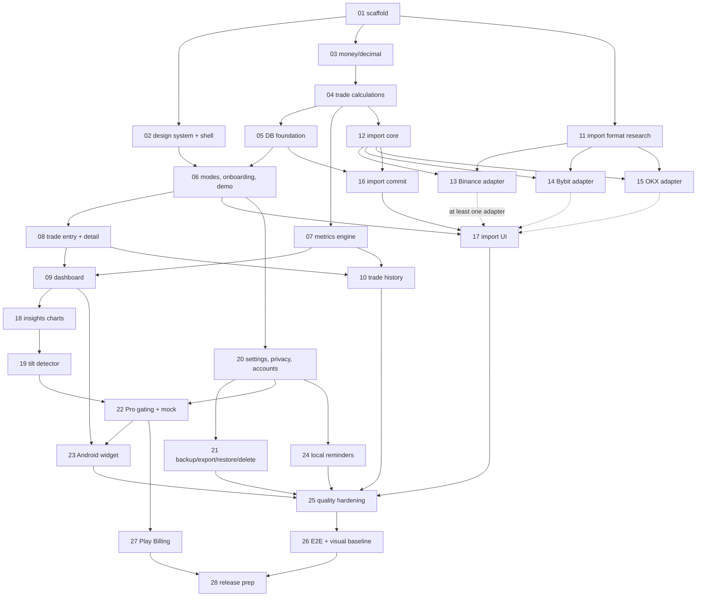

# Ledgerline — Implementation roadmap (v1, Android)

Ledgerline is a private, offline crypto trading journal (Expo / React Native + TypeScript, Android first).
Read first: `docs/workflow.md` (how to execute a step), `docs/architecture.md`, `docs/data-model.md`,
`docs/financial-semantics.md`, `docs/import-spec.md`, `docs/design-system.md`, `docs/testing-strategy.md`,
`docs/monetization.md`, `docs/decisions.md`, `docs/launch-checklist.md`.

**Legend.** Gates: **A** = agent gate (`npm run check`), 📱 **D** = device gate (emulator + Maestro), 🎨 **V** = visual gate.
A step is _done_ when all of its gate boxes are ticked. The next dependent step may start when **A** is ticked
(see workflow). `U-xx` = user action in `docs/launch-checklist.md`.

**First recommended execution task: `01-scaffold`.**

## Dependency graph

**Parallel lanes** (for multiple agents): after 01, run lane A (02), lane B (03→04→05 and 07, 12), and
lane C (11, which needs U-04). The import adapters 13/14/15 are independent of each other. 20 and 24 can run alongside 17–19.

## Phase 0 — Foundation

- [x] **01-scaffold** — Expo + TS strict + expo-router + lint/format/Jest + dev build on the emulator · deps: — · 📱
  - Accept: `npm run check` green with one sample test; `npx expo run:android` launches a "Ledgerline" placeholder; boundary lint rules active; README run guide.
  - Gates: [x] A [ ] D (pending Dorian / U-02 emulator in this VM)
- [x] **02-design-system-shell** — tokens, fonts, primitives, 4-tab shell, Maestro harness · deps: 01 · U-01 · 📱🎨
  - Gates: [x] A [ ] D [ ] V
- [x] **03-money-decimal** — `Dec` wrapper, parse/canonical/format, units · deps: 01
  - Gates: [x] A
- [x] **04-trade-calculations** — trade types, validation, PnL/fees/funding/R, positions from fills · deps: 03
  - Gates: [x] A
- [x] **05-db-foundation** — Db, migrations, repos, calc-on-write, DbProvider · deps: 04
  - Gates: [x] A [ ] D
- [x] **07-metrics-engine** — periods, summary, buckets, series · deps: 04
  - Gates: [x] A (DST/benchmark tests partial)

## Phase 1 — Core journal

- [x] **06-modes-onboarding-demo** — demo/real DB, onboarding, demo seed, DEMO sheet · deps: 02, 05 · 📱🎨
  - Gates: [x] A [ ] D [ ] V
- [x] **08-trade-entry-detail** — quick add, computed panel, detail, delete · deps: 04, 05, 06 · 📱🎨
  - Partial: edit/tags/deep-link polish pending.
  - Gates: [x] A [ ] D [ ] V
- [x] **09-dashboard** — period selector, hero PnL, tiles, recent trades, FAB · deps: 07, 08 · 📱🎨
  - Partial: equity chart SVG pending.
  - Gates: [x] A [ ] D [ ] V
- [x] **10-trade-history** — FlashList history, FAB, detail navigation · deps: 07, 08 · 📱🎨
  - Partial: day groups, search, filters, undo pending.
  - Gates: [x] A [ ] D [ ] V

## Phase 2 — CSV import

- [ ] **11-import-format-research** — real-sample evidence, format docs, anonymizer script, fixtures · deps: 01 · **U-04, U-05**
  - Partial: exchange format docs marked unsupported; anonymizer/fixtures blocked on U-04.
  - Gates: [x] A (honest unsupported state)
- [x] **12-import-core** — decode/parse/detect/plan + test adapter · deps: 04 (03)
  - Partial: fill positions, 50k perf/property tests pending.
  - Gates: [x] A
- [ ] **13-import-binance** — Binance adapter · deps: 11, 12 · _skip if step 11 marked Binance unsupported_
  - Accept: the real fixture's expected totals match exactly; quirks from the format doc tested.
  - Gates: [ ] A
- [ ] **14-import-bybit** — Bybit adapter · deps: 11, 12 · _skip if unsupported_
  - Gates: [ ] A
- [ ] **15-import-okx** — OKX adapter (contract-size rule) · deps: 11, 12 · _skip if unsupported_
  - Gates: [ ] A
- [x] **16-import-commit** — transactional commit + demo guard · deps: 05, 12
  - Partial: undo/concurrency tests pending.
  - Gates: [x] A
- [x] **17-import-ui** — import screen; exchange tiles show **Not yet** · deps: 06, 16 · 📱🎨
  - Partial: file picker, preview, commit flow blocked until U-04 adapters.
  - Gates: [x] A [ ] D [ ] V

## Phase 3 — Insights

- [ ] **18-insights-charts** — calendar heatmap (month nav), hour-of-day chart, sample-size caveats · deps: 09 (07) · 📱🎨
  - Gates: [ ] A [ ] D [ ] V
- [ ] **19-tilt-detector** — 3 rule-based tilt flags, thresholds settings, "how it's calculated" sheets, dashboard tilt banner · deps: 18 · 📱🎨
  - Accept: rules match the plan definitions on synthetic sequences; min-sample gating; no predictive wording.
  - Gates: [ ] A [ ] D [ ] V

## Phase 4 — Settings, data ownership, Pro, Android surfaces

- [x] **20-settings-privacy-accounts** — settings hub, privacy copy, import link · deps: 06 · 📱🎨
  - Partial: accounts CRUD, app lock pending.
  - Gates: [x] A [ ] D [ ] V
- [ ] **21-backup-export-restore-delete** — backup placeholder screen · deps: 20 (05) · 📱
  - Gates: [ ] A [ ] D
- [ ] **22-pro-gating** — Pro placeholder + `npm run check:release` · deps: 19, 20 · U-06 · 📱🎨
  - Gates: [x] A (release script only) [ ] D [ ] V
- [ ] **23-android-widget** — spike, then a today-summary widget with a quick-add deep link, privacy/demo handling · deps: 09, 22 · 📱🎨
  - Gates: [ ] A [ ] D [ ] V
- [ ] **24-local-reminders** — optional daily journaling reminder, local only, Android 13 permission flow · deps: 20 · 📱
  - Gates: [ ] A [ ] D

## Phase 5 — Quality and release

- [ ] **25-quality-hardening** — a11y audit/fixes, performance budgets with a 10k seed, error boundary/recovery screen, state audit · deps: 10, 17, 21, 23, 24 · 📱
  - Gates: [ ] A [ ] D
- [ ] **26-e2e-visual-baseline** — `e2e/onboarding.yaml` stub · deps: 25 · 📱🎨
  - Gates: [ ] A [ ] D [ ] V
- [ ] **27-play-billing** — `PlayBillingProvider`, acknowledge, restore, refund handling, license-tester test plan · deps: 22 · **U-07, U-08** · 📱
  - If U-07/U-08 aren't done, see the plan's "release without billing" decision point.
  - Gates: [ ] A [ ] D
- [ ] **28-release-prep** — release build config, signing guide, privacy policy draft, store listing + Data safety draft, permissions audit, run guide, checklist execution · deps: 26, 27 · **U-03, U-09, U-10, U-11** · 📱
  - Gates: [ ] A [ ] D

## Explicitly out of v1

iOS, API sync, funding-file import, encrypted backups, cloud anything, push notifications, AI features,
localization. See `docs/future-scope.md`.
